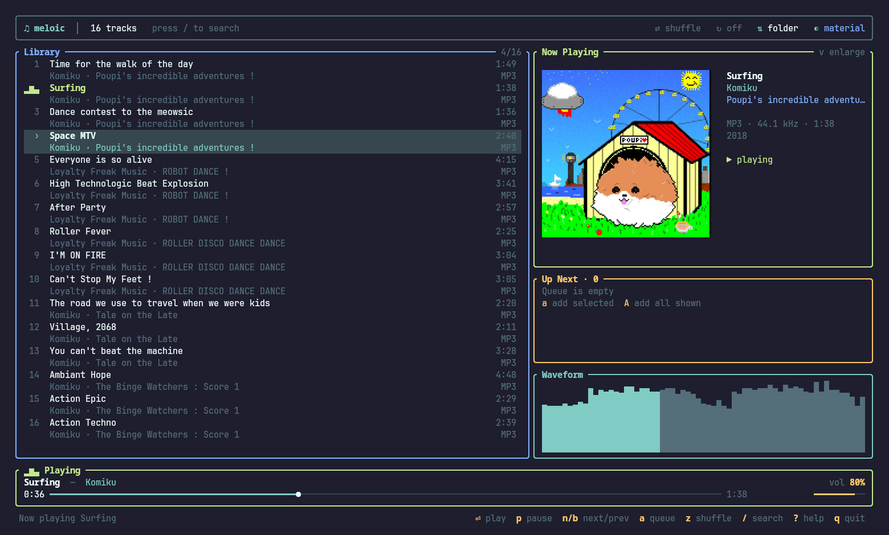
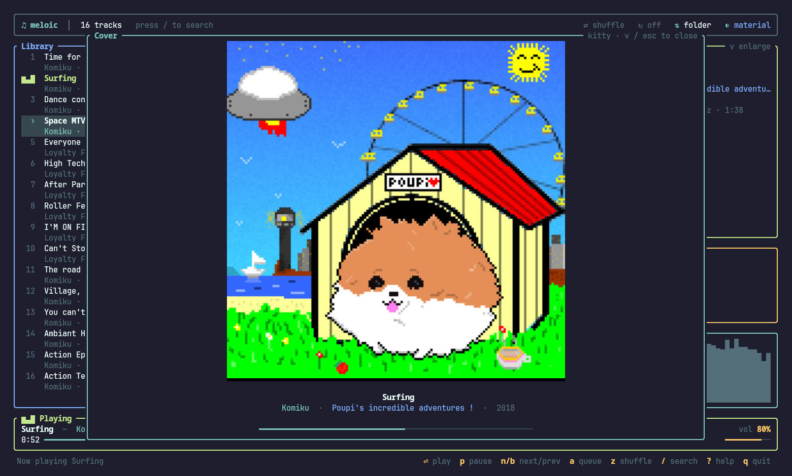
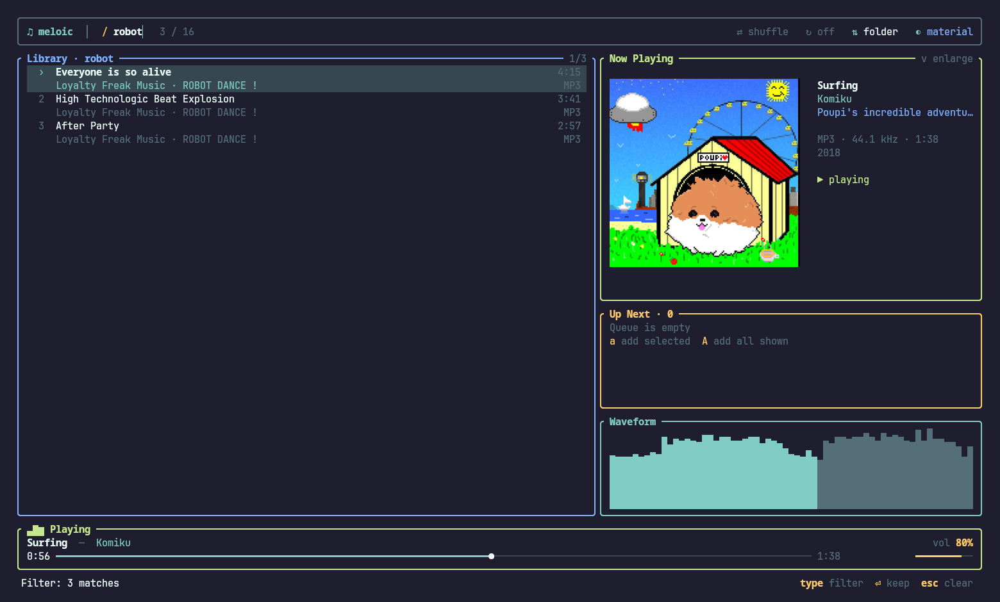
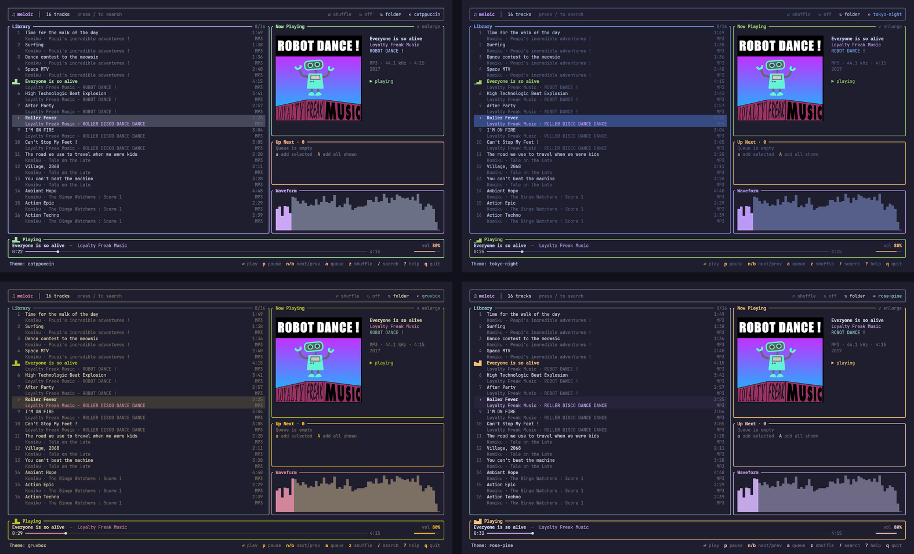
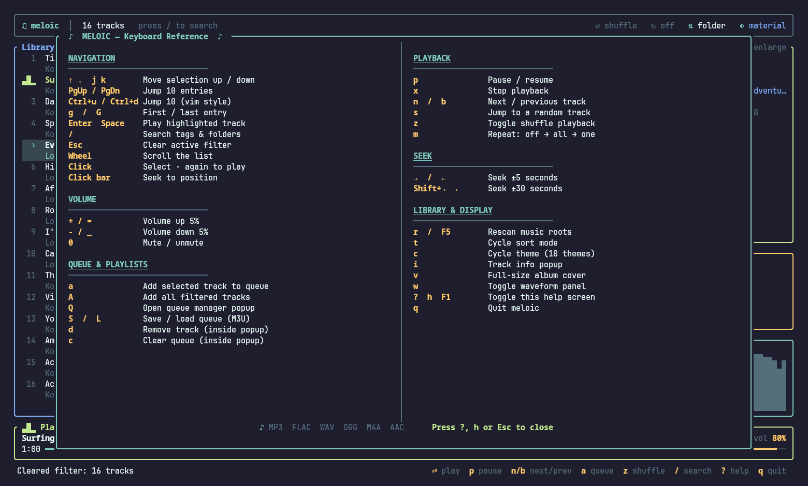

<div align="center">

# meloic

**A fast terminal music player written in Rust.**

Album art, waveform display, queue management, ten color themes and vim-style navigation, all in a single terminal window.

[](https://crates.io/crates/meloic)
[](https://aur.archlinux.org/packages/meloic)
[](LICENSE)
[](https://www.rust-lang.org)



</div>

---

## Features

**Interface**
- **Real album covers.** In terminals with a graphics protocol (kitty, Sixel) covers are drawn at full pixel resolution. Other terminals use a color halfblock fallback.
- **Full-size cover view.** Press `v` to show the cover at full size, with track details and progress.
- **Waveform display.** Each track is rendered as a bar waveform, with playback progress highlighted.
- **10 themes:** Catppuccin, Tokyo Night, Nord, Gruvbox, Solarized, Rosé Pine, Dracula, Material, Monokai and Neon.
- **Responsive layout.** The sidebar is hidden automatically on narrow terminals.

**Playback**
- MP3, FLAC, WAV, OGG, M4A and AAC
- Seek, volume, mute, repeat (off / all / one) and shuffle, all remembered between sessions
- Automatic advance to the next queued or listed track

**Library**
- Live search across **title, artist, album and folder**
- Tag-aware library: each row shows title, artist, album and duration
- Sorting by name or folder, random track selection, vim-style and arrow-key navigation
- **Mouse support:** scroll the list, click to select, click again to play, click the progress bar to seek
- Track info popup with tags, sample rate, bit depth, channels and file size

**Queue and playlists**
- Build and manage a playback queue
- Save and load the queue as an M3U playlist, or start meloic with any `.m3u` / `.m3u8` file

## Screenshots

<table>
  <tr>
    <td align="center"><br><sub>Full-size cover view (<code>v</code>)</sub></td>
    <td align="center"><br><sub>Live search (<code>/</code>)</sub></td>
  </tr>
  <tr>
    <td align="center"><br><sub>Built-in themes (<code>c</code>)</sub></td>
    <td align="center"><br><sub>Keyboard reference (<code>?</code>)</sub></td>
  </tr>
</table>

> The music in these screenshots is in the **public domain** (CC0 1.0): albums by [Komiku](https://archive.org/details/Komiku-Poupis_incredible_adventures) and [Loyalty Freak Music](https://archive.org/details/ROBOTDANCE), hosted on the Internet Archive.
> You can fetch the same library with [`scripts/fetch_demo_library.py`](scripts/fetch_demo_library.py).

## Installation

### Arch Linux (AUR)

```bash
yay -S meloic
```

### Cargo

```bash
cargo install meloic
```

### From source

```bash
git clone https://github.com/Huseynteymurzade28/meloic.git
cd meloic
cargo build --release
./target/release/meloic
```

**Requirements:** Rust **1.85+** (edition 2024). On Linux you also need the ALSA development headers: `alsa-lib` on Arch, `libasound2-dev` on Debian/Ubuntu.

## Usage

```bash
meloic                      # scan the default music folders
meloic ~/Music/Jazz         # scan only this folder
meloic ~/party.m3u          # start with a playlist in the queue
```

With no arguments, meloic scans every one of these folders that exists: `~/Music`, `~/music`, `/Music`, `./Music`, `./music` and the current directory.

### Album covers

meloic reads the cover embedded in each file's tags and checks your terminal when it starts:

| Terminal | Cover rendering |
| --- | --- |
| kitty, Ghostty and other kitty-graphics terminals | Full-resolution image |
| Sixel terminals (e.g. foot) | Full-resolution image |
| Everything else, and inside tmux | Colour halfblocks (`▀`) |

To force halfblocks, run `MELOIC_NO_GRAPHICS=1 meloic`. The cover popup shows which mode is in use in its top-right corner.

## Keybindings

Press <kbd>?</kbd> inside meloic for the full reference.

<table>
<tr><td valign="top">

**Navigation**
| Key | Action |
| --- | --- |
| `↑` `↓` / `j` `k` | Move selection |
| `PgUp` `PgDn` / `Ctrl+u` `Ctrl+d` | Jump 10 rows |
| `g` / `G` | First / last track |
| `Enter` / `Space` | Play selected |
| `/` | Search |
| `Esc` | Clear search filter |

**Queue & playlists**
| Key | Action |
| --- | --- |
| `a` | Add selected to queue |
| `A` | Add all shown tracks |
| `Q` | Open queue manager |
| `S` / `L` | Save / load queue (M3U) |

</td><td valign="top">

**Playback**
| Key | Action |
| --- | --- |
| `p` | Pause / resume |
| `x` | Stop |
| `n` / `b` | Next / previous track |
| `←` `→` | Seek ±5s |
| `Shift` + `←` `→` | Seek ±30s |
| `+` / `-` | Volume up / down |
| `0` | Mute |
| `z` | Toggle shuffle |
| `m` | Repeat: off → all → one |
| `s` | Jump to a random track |

**Display**
| Key | Action |
| --- | --- |
| `v` | Full-size album cover |
| `i` | Track info |
| `w` | Toggle waveform |
| `c` | Next theme |
| `t` | Cycle sort mode |
| `r` / `F5` | Rescan library |
| `q` | Quit |

</td></tr>
</table>

**Mouse:** use the wheel to scroll, click to select, click the same track again to play it, and click the progress bar to seek.

## Configuration

meloic saves its state in `~/.config/meloic/`:

| File | Contents |
| --- | --- |
| `settings` | Theme, volume, mute, shuffle, repeat and sort mode, saved whenever they change |
| `queue.m3u` | The queue saved with `S`, loaded with `L` |

`settings` is a plain `key = value` file and can be edited by hand:

```ini
theme = catppuccin
volume = 80
muted = false
shuffle = false
repeat = off        # off, all, one
sort = name-asc     # name-asc, name-desc, folder
```

Invalid values are ignored and fall back to defaults. Settings from older versions (the `theme` file) are migrated automatically.

## Demo library

To try meloic or record a demo without using copyrighted music, download a small public-domain library:

```bash
python3 scripts/fetch_demo_library.py demo-music   # Python standard library only, ~60 MB
meloic demo-music
```

This downloads 16 tracks from 5 CC0 albums by Komiku and Loyalty Freak Music, with tags and covers already embedded, and writes a `CREDITS.md` next to them. Before downloading, the script checks that each album on the Internet Archive is still marked CC0.

## Project structure

```
src/
├── main.rs            # Entry point and argument handling
├── library.rs         # Music folder scanning
├── metadata.rs        # Tags and embedded cover art (lofty)
├── playlist.rs        # M3U read/write, config paths
├── waveform.rs        # Background waveform decoding
└── ui/
    ├── mod.rs         # Terminal setup and main loop
    ├── app.rs         # Application state, playback, themes
    ├── events.rs      # Keyboard and mouse input
    ├── widgets.rs     # All panels and popups
    ├── cover.rs       # Album cover rendering (graphics protocols / halfblocks)
    └── help.rs        # Keyboard reference screen
scripts/
└── fetch_demo_library.py  # Downloads a public-domain demo library
```

Built with [ratatui](https://ratatui.rs), [rodio](https://github.com/RustAudio/rodio), [lofty](https://github.com/Serial-ATA/lofty-rs) and [ratatui-image](https://github.com/benjajaja/ratatui-image).

## Contributing

Issues and pull requests are welcome.

1. Fork the repository
2. Create a branch: `git checkout -b feature/my-feature`
3. Commit your changes and run `cargo fmt` and `cargo clippy`
4. Open a pull request

Bug reports and feature requests: [open an issue](https://github.com/Huseynteymurzade28/meloic/issues).

## License

meloic is released under the [MIT License](LICENSE).

Demo music: Komiku and Loyalty Freak Music, CC0 1.0 (public domain).

